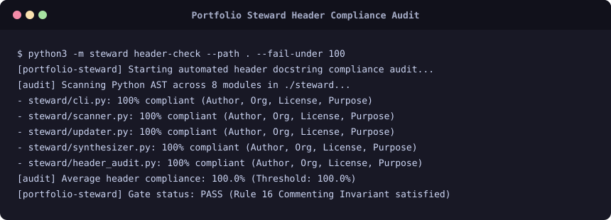
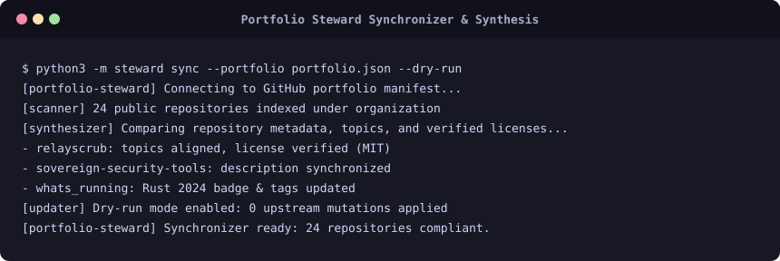

# GitHub Portfolio Steward

A Python command-line project for inspecting local or GitHub repositories, proposing descriptions and topics, and checking source-file headers. Remote operations use the GitHub CLI (`gh`); recommendations are generated from repository metadata and file markers and need human review.

## What it includes

- `scan` inspects a local directory or retrieves GitHub repository information.
- `describe` proposes a repository description and topics.
- `audit` reports missing descriptions and topics for retrieved repositories.
- `header-check` checks source-file headers for specified fields.
- `sync` proposes metadata changes and can apply them through `gh repo edit`.

## Requirements

Python 3.8 or later is declared in [pyproject.toml](pyproject.toml). Remote operations also need an installed, authenticated [GitHub CLI](https://cli.github.com/) with appropriate repository access.

## Usage

From the repository directory:

```sh
python3 -m steward --help
python3 -m steward scan --local .
python3 -m steward describe --local .
python3 -m steward header-check --path .
python3 -m unittest discover -s tests -v
```

Remote inspection and preview examples:

```sh
python3 -m steward scan --limit 20
python3 -m steward audit --limit 50
python3 -m steward sync --repo OWNER/REPOSITORY --dry-run
```

**Review before changing GitHub:** `sync --apply` invokes `gh repo edit` and may change descriptions or topics. The current code treats `--apply` as a live update even if `--dry-run` is also supplied. For a single `--repo`, it constructs an empty metadata summary rather than retrieving the current description first, so a proposed description can replace existing wording. The inspection-error fallback also refers to a name not imported in the CLI. Review plans and current repository metadata carefully; current behavior has not been independently verified end to end in this documentation review.

The metadata scores are heuristic, not evidence that generated claims are accurate. A header-check result reflects the files and rules checked, not the quality or safety of a project.

## Visual Walkthrough & Diagnostics

<p align="center">
  
</p>

<p align="center">
  
</p>

## Magi Standards & AI Contributor Onboarding

All portfolio automation tools, repository scanners, and metadata synthesizers adhere to the **[Magi Bible: Engineering Foundations & Safety Standards for AI Coding](MAGI_BIBLE.md)** and **[MAGI_LOOK_HERE.md](MAGI_LOOK_HERE.md)**:
- **[MAGI_LOOK_HERE.md](MAGI_LOOK_HERE.md)**: Universal contributor & AI agent onboarding guide, visual walkthrough requirements, zero-PII validation rules.
- **[MAGI_BIBLE.md](MAGI_BIBLE.md)**: Core engineering foundations, multi-seat governance, and verification checklists.
- **Rule 16 Commenting Invariant:** Code contains comprehensive structural headers and inline rationale.
- **Safe Dry-Run Gating:** All mutating synchronization operations require explicit non-dry-run confirmation.
- **Zero Secrets & Leak-Scrubbed:** Free of private tokens, paths, or personal hostnames.

## License

[MIT License](LICENSE).

